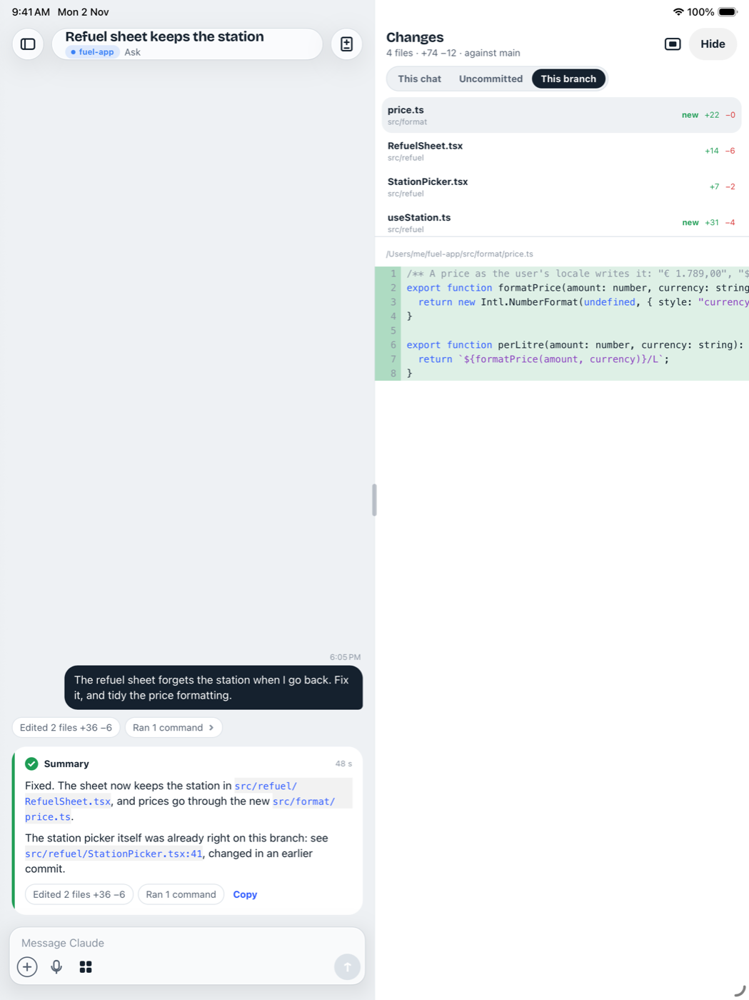
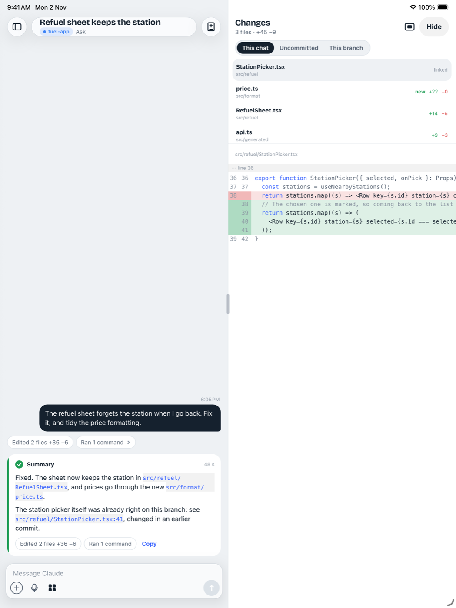
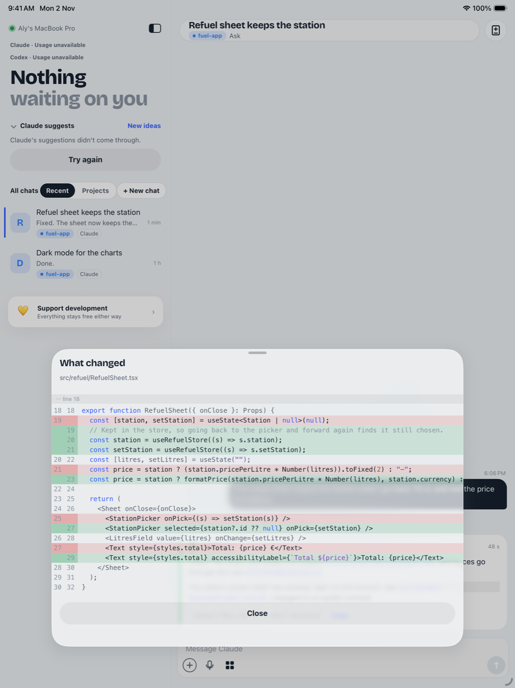

# iPad Changes: #388 on a simulator

iPad Air 13-inch simulator, portrait, running the code on `feat/mobile-changes-scopes` with a made-up chat and a fake Mac.

## This branch

The pane's third view: the branch's files, compared with main, and a file's diff in that view.

## A link to a file the chat never changed

`src/refuel/StationPicker.tsx:41` tapped in the summary. It opens in the pane, marked "linked" at the top, with the branch's change to it (it was committed earlier), not in a sheet. `api.ts` is a script's edit, now on This chat's list after Claude's own edits.

## The sheet, with the chats pinned

No room for the pane, so a link still opens the sheet. It is now 80% of the screen's width, not 640 pt.

