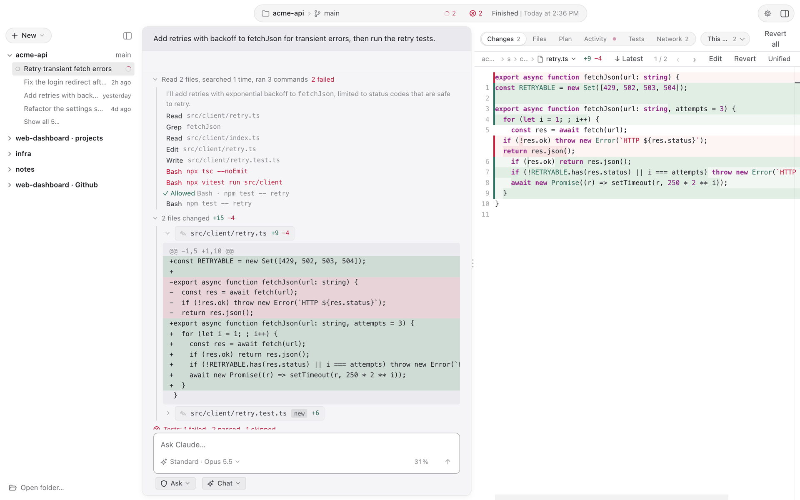

# Lantern for Claude Code

A Mac app for the `claude` CLI you already have: see what Claude is doing as cards and diffs, and steer it one reviewable step at a time. **[See all features →](docs/FEATURES.md)**

## What it does

| | |
| --- | --- |
| **A chat you can read** | Every tool call is a card, edits and new files are diffs, and Allow / Deny prompts show up in the conversation instead of scrolling past. |
| **Step by step** | Claude works one page at a time and stops after each. Build, review a pull request file by file, debug from evidence, or review a design as a map. You approve a page, ask about it, or change it. |
| **Teams on a canvas** | A Lead splits the work between agents, each in its own git worktree and branch. They float on a canvas you can pan and zoom, and you decide which branches merge. Start agents in roles (a builder, a read-only reviewer, a tester…) or a whole team from a template. |
| **A side panel for the rest** | Changes, Files, Plan, Tests, Checks and Network sit beside the chat: every diff, an editor, the plan or map, test results, pull request checks and API traffic from [Network Monitor](https://github.com/alyakan/network-monitor). Pin the ones you use; the rest are in a ⋯ menu. |
| **Free up disk space and see what uses your RAM** | The Storage button in the title bar opens a panel with a Disk tab, which scans your Mac for what can be cleared (git worktrees, stale projects, build output, caches, simulators, the Trash), a port of [Sweep](https://github.com/alyakan/sweep-my-mac)'s scanners that checks git first: a worktree or project with unsaved work in it is shown but can't be deleted. Claude can run the scan and tick what it thinks is safe, with a reason each; only you press Delete, and every item is checked again just before it goes. Its Memory tab shows what your RAM is used by, app by app, read-only. |
| **In your menu bar** | A lantern in the Mac's menu bar with a live readout (memory used, disk free) that turns amber or red when either runs low. Click it for a small panel in your theme: memory and the apps using it, disk space, your open chats (what needs you first) and a box to start a new chat in any project. Settings ▸ General ▸ Menu bar turns it off, keeps just the lantern, or shows it all, and picks what each part shows. |
| **Yours to set up** | **Ask** or **Auto** permissions, a **Models** preset per chat (who does the work), a sidebar of every project, History for past chats, and a command palette for all of it. |

## Install and get started

Lantern needs macOS and [Claude Code](https://docs.claude.com/en/docs/claude-code), installed and logged in. Lantern runs your `claude` CLI and never handles authentication itself.

1. Download the latest `.dmg` from [Releases](../../releases), open it and drag Lantern to Applications. The app is signed and notarized by Apple, so it opens like any other Mac app.
2. Open Lantern. It finds `claude` by itself and checks it's signed in; if it isn't, it says how to fix that.
3. Open a folder (⌘O, or pick a recent project). You land on a start screen: say what you're after, or pick **Build**, **Review a PR**, **Debug**, **Design** or **Start a team**.

Lantern updates itself: when a new release is out, "Update ready" appears under the chat box.

## More

- [All the features, with screenshots](docs/FEATURES.md)
- [Building from source](#build-from-source)
- [Contributing](CONTRIBUTING.md)
- [License](LICENSE): MIT. The phone app in [`mobile/`](mobile/LICENSE) is source-available under the [PolyForm Noncommercial License 1.0.0](https://polyformproject.org/licenses/noncommercial/1.0.0): free to read, run, change and share for non-commercial use; commercial use needs permission. Lantern is an independent project and is not affiliated with or endorsed by Anthropic.

## Build from source

Requires Node 20.19 or newer (see `.nvmrc`) and a stable Rust toolchain.

    npm install
    npm run tauri dev

To build the app bundle:

    npm run tauri build -- --bundles app

Tests: `npm test` and `cargo test --manifest-path src-tauri/Cargo.toml`. Manual checks before a release are in [docs/SMOKE_TEST.md](docs/SMOKE_TEST.md).
