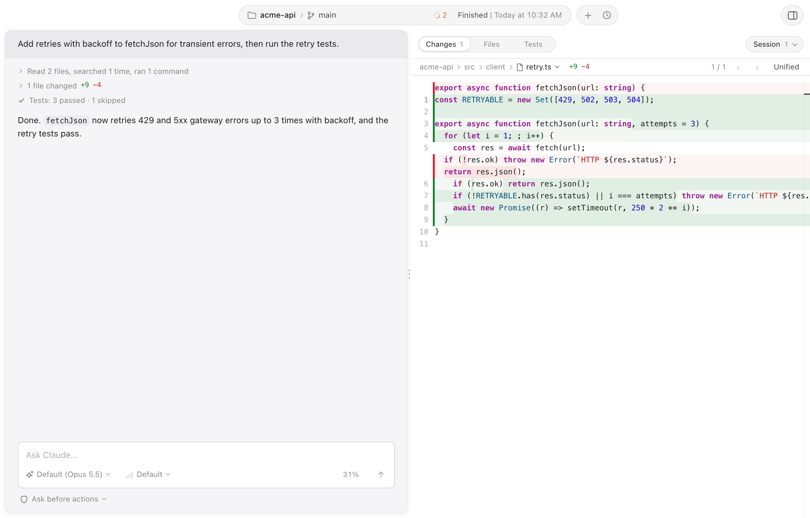
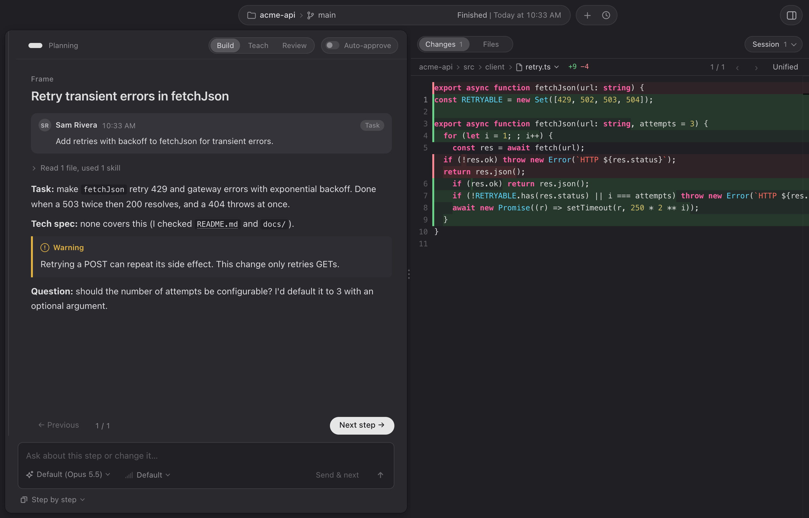

# Lantern for Claude Code

A macOS desktop app for the `claude` CLI you already have. It shows what Claude is doing while it works (tool calls, file edits as diffs, commands still running in the background), and it can walk through a task one reviewable step at a time.

## Why

The terminal is a fine place to talk to Claude Code, but a hard place to follow a long turn: edits scroll past, background commands disappear, and a twelve-step plan arrives as one wall of text. Lantern keeps the same Claude Code underneath and gives each piece room to be read.

## Features

- **Readable turns.** Every tool call is a card. Edits and new files show as diffs, and the Changes list opens any touched file in a full side-by-side diff.
- **Ask and Auto.** In Ask mode edits apply and anything else asks you with Allow/Deny. In Auto mode Claude Code's own classifier approves most actions.
- **Step by step.** One page at a time, with Previous and Next; you approve a page, ask about it, or ask for a change, and only that page is rewritten. Claude suggests how to work from your task, and starts when you say so: **Build** plans and builds a step per page, **Learn** does the same and explains the why, **Review** walks a pull request or branch a file per page, **Debug** finds the cause from evidence before fixing it, and **Architecture** reviews the architecture and design (not the code) of a feature, fix or PR: one diagram of the whole thing, then a page per part with concerns you agree with or reject. The map lives in the right pane's **Map** tab, drawn like the Agents graph: the layers are bands (UI, business logic, interfaces, implementations, external), each box says whether it's done, in progress or planned, every place an arrow crosses a boundary is marked, Lantern flags an arrow that goes around a layer, and the problems Claude found are listed with them; it lights the part you are on, hovering a box says what it does, clicking one opens its page, and it pans and zooms (drag, pinch or ⌘-scroll, Fit). Any Mermaid diagram in a chat has **Expand**, to look at it full size. You can also pick one yourself; switching partway through a chat reminds Claude how the new flavour works. Lantern reads Claude's pages by their headings, and when one doesn't read as a page it tells Claude with your next message, with the headings to use. Claude also has Lantern's own tools: **steps_guide** (the flavours' formats, when it's unsure) and **review_target** (what the Changes pane compares, so a PR opened mid-review shows straight away). The **Summary** tab beside Changes lists the plan so far: each step with what was done, the files it changed and whether it's built, and a click opens its page. In Build, the plan gets **locked**: Claude ends planning by asking you to lock it, builds exactly those steps, and if the build shows the plan needs a change it stops on a **Plan update** page and asks first. Building straight away without a plan has nothing to lock; steps just appear as they're written. **Export** there copies or saves the plan as a markdown document: the Frame, the plan as a table with each step's status, and (optionally) what each step did and the files it changed.
- **Reviews.** Point Step by step at a pull request or branch. Each changed file gets its own page, findings become cards you Agree with or Reject, and your verdicts go back to Claude together. A branch stacked on another is compared with the branch it was built on, not the default branch: Claude names the base in the review's Frame (from the branch's pull request, or its history), and without that Lantern finds the nearest branch it was built on.
- **Tests tab.** Test runs from pytest, jest, vitest, cargo and xcodebuild are parsed into passes and failures with file:line links.
- **Network tab.** With [Network Monitor](https://github.com/alyakan/network-monitor) open as your app's proxy, Claude can search and read the traffic it captured. What Claude reads has auth headers, cookies, and URL parameters and JSON or form fields with credential-like names (`token`, `password`, `secret`, `privateKey`…, and a URL's `key` and OAuth `code`) redacted; anything else in a body reaches it as it is. Tell it which requests matter and it saves a watch for the project: the **Network** tab then lists every matching request as it happens, newest first, with its response as a foldable JSON tree, an outline of its keys (nulls and empty lists marked), and its headers. **Summarize** asks Claude to read a response and put a summary of it above the JSON. Watches and summaries are kept per project; the responses themselves stay in memory, never on disk. The traffic itself isn't per project: Claude in any chat can search and read everything Network Monitor captured, not just the requests a project's watches match.
- **Shell commands.** Start a message with `!` and the box turns into a terminal: `!git status` runs in the chat's folder, its output streams in, and Claude sees it with your next message. Long-running commands (a dev server) keep going until you stop them. When a command asks something (a password, a y/n) you answer it in place; passwords go in a secret field and only to the command.
- **Harness presets.** Pick who does what per chat from the chip under the box: Balanced (Sonnet, with Opus as the advisor Claude consults at decision points and Haiku subagents), Thrifty, Max, or your own, set up in Settings → Harness.
- **Agents tab.** A live graph of the turn: the main agent at the root, the advisor beside it, subagents below with the model each runs on, and the kinds of tools each uses, with work travelling the edges as it happens. A log of who did what underneath, then what the turn cost per model.
- **Orchestras.** **New orchestra** (the icon beside New session) starts a main agent that runs a team. It starts worker agents, each in its own git worktree and branch (or in your folder, for work that only reads), sees what they do, and writes to them; and you can talk to any of them directly. The app becomes a canvas of floating chats tethered to the main agent: drag a title to move one, its corner to resize it, the background to pan, pinch or ⌘-scroll to zoom (zoomed out, agents become cards, and a click zooms in). A worker's permission prompts appear in its own window, a pill takes you to the next agent that needs you, and **Team** lists everyone with their latest words and what the team has cost. When the main agent reaches for its built-in helper (the Agent tool, which runs inline where you can't see it), a card asks where it should run: **Run on canvas** has the main agent start it as a worker instead, **Run inline** lets it through, and a box makes the answer the same for the rest of that chat. The main agent can ask you to merge a worker's branch, and only you can approve it. The team runs on Auto or Ask (asked once per project), and workers never get more freedom than the main agent. ⇧⌘C switches between the canvas and the chat view, and a team comes back when Lantern reopens.
- **Settings (⌘,).** General: which events notify you (a turn finishes, Claude needs you, a turn fails), a pause for an hour, the toast sound, the theme (follow macOS, light or dark) and the text size. Your MCP servers with their status: log in, reconnect, turn off, add, edit or remove them (through Claude Code's own settings). An edit can move a server to another scope, and a secret never goes into the project's committed `.mcp.json`. Your skills, the project's and plugins', each with a preview of its file.
- **/ and @ anywhere.** Type `/` anywhere in a message for skills, commands and MCP prompts (sorted into sections, with where each comes from), and `@` to point Claude at a file. MCP tool calls in the chat name their server ("Linear · create issue").
- **Edit files.** The Files tab is an editor with code completion (types and members, hover docs, syntax errors for TypeScript, JavaScript, JSON, CSS and HTML; words from the file elsewhere): change a file, ⌘S to save. The change shows up in the Changes tab like Claude's, and if Claude (or git) changes the file while you have unsaved edits, you choose between your version and the one on disk before anything is overwritten.
- **Read markdown.** A `.md` file opens as a styled document (tables, code, callouts, task lists); **Edit** switches to the editor, and the preview shows your unsaved edits too.
- **Long pastes.** Pasting more than a few lines into the box shows `[Pasted text #1 · 120 lines]` instead of the text; the whole text is sent. Your sent messages show at most three lines, with **Show more** for the rest.
- **Search.** ⌘P finds files, ⌘⇧F searches text (regex, case, whole word), ⌘F searches inside an open file or diff.
- **History and sessions.** Pick up any earlier Claude Code session for a folder, including ones started in the terminal. Several chats can run side by side, with a notice when one finishes or needs you. The chats open when Lantern closes are offered back the next time it opens.
- **Moved folders.** Claude Code keeps a folder's sessions under its path, so after you move a repository its history stays where it was. **Bring old sessions here…** (⇧⌘R, or the folder menu) looks for the places the open project was before: folders with the same name, and places it was already brought over from. It lists each with its session count, and brings the ones you check into the project's History. Sessions are copied in, never moved or overwritten, and the original files stay where they are. **Details** can also bring the MCP servers, permissions and memory Claude Code keeps for the path. History offers the same thing when there are old sessions to bring, and the folder menu shows a "moved?" entry for a recent folder whose path has gone, when exactly one folder with the same name is there. Nothing moves until you confirm.

## Requirements

- macOS.
- [Claude Code](https://docs.claude.com/en/docs/claude-code) installed and logged in. Lantern runs your `claude` CLI and never handles authentication itself.

## Install

Download the latest `.dmg` from [Releases](../../releases), open it and drag Lantern to Applications. The app is signed and notarized by Apple, so it opens like any other Mac app.

From 0.1.1 on, Lantern updates itself: when a new release is out, "Update ready" appears under the chat box. Click it to restart onto the new version (a progress screen shows while it installs), or leave it and it installs when you quit. **Lantern ▸ Check for Updates…**, or Settings (⌘,) ▸ Updates, looks right now and shows the download as it goes.

## Build from source

Requires Node 20.19 or newer (see `.nvmrc`) and a stable Rust toolchain.

    npm install
    npm run tauri dev

To build the app bundle:

    npm run tauri build -- --bundles app

Tests: `npm test` and `cargo test --manifest-path src-tauri/Cargo.toml`. Manual checks before a release are in [docs/SMOKE_TEST.md](docs/SMOKE_TEST.md). See [CONTRIBUTING.md](CONTRIBUTING.md) to send a change.

## License

[MIT](LICENSE). Lantern is an independent project and is not affiliated with or endorsed by Anthropic.
