# What Lantern does

Lantern is a Mac app for the `claude` CLI you already use. This page walks through it area by area. The screenshots are Lantern's own screens showing demo data (a project called `acme-api`); the macOS menu bar isn't in them, so where something lives there, the text says so.

- [Getting started](#getting-started)
- [Permissions and Workflow](#permissions-and-workflow)
- [A chat](#a-chat)
- [Step by step](#step-by-step)
- [Teams](#teams)
- [The sidebar and History](#the-sidebar-and-history)
- [The side panel](#the-side-panel)
- [Settings](#settings)
- [Keyboard shortcuts and the command palette](#keyboard-shortcuts-and-the-command-palette)

## Getting started

The first time (and whenever no folder is open) Lantern shows one **Open folder…** button, your recent projects as cards (name, where it is, when you last used it; a click opens it), and a line saying Claude Code is installed and signed in. If `claude` isn't signed in, the line says so, with the fix (run `claude` in a terminal and type `/login`) and **Check again**; if Lantern can't find `claude` at all, it says that and how to install it. The side panel isn't there until a folder is open.

Open a folder (⌘O, or **Open folder…** at the bottom of the sidebar) and you land on the start screen. It shows the box, for saying what you're after in your own words, and five cards:

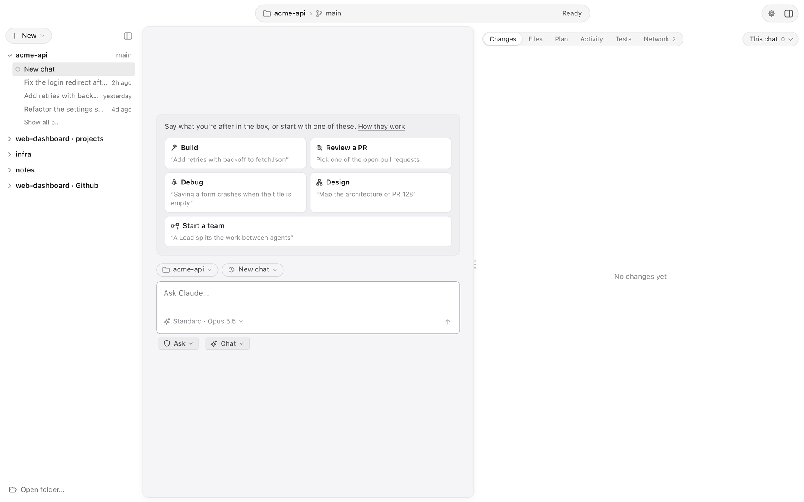

- **Build**: plan and build something one small step at a time.
- **Review a PR**: lists the repository's open pull requests (from `gh pr list`) and starts a review of the one you pick. If `gh` isn't installed or logged in, it says so, and you can still type a PR number.
- **Debug**: find the cause of a bug from evidence before anything is fixed.
- **Design**: map how a feature, a fix or a PR fits together, before or without any code.
- **Start a team**: a Lead that splits the work between agents.

Build, Debug and Design start a [Step by step](#step-by-step) chat in that flavour, and Start a team starts a [Team](#teams). You can also ignore the cards and just type.

The same five are in the **Work** menu of the macOS menu bar (Start a Team is ⇧⌘N) and in the [command palette](#keyboard-shortcuts-and-the-command-palette).

## Permissions and Workflow

Every chat has two settings, as chips under the box.

**Permissions** says how much Claude may do without asking:

- **Ask**: edits apply as Claude makes them; commands and other actions stop and ask you with Allow or Deny.
- **Auto**: Claude Code's own classifier approves routine actions and stops risky ones, so you're rarely asked.

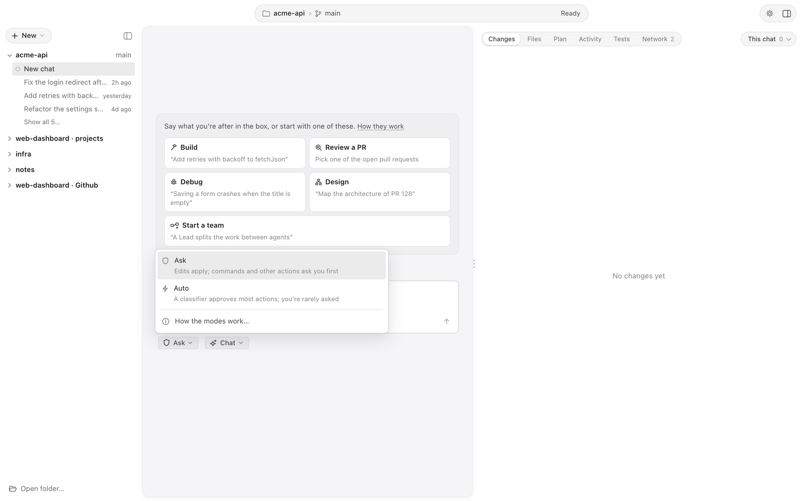

**Workflow** says how the chat runs:

- **Chat**: a plain conversation.
- **Step by step**: one page at a time, which you approve or change.
- **Team**: this chat becomes the Lead of a team of agents.

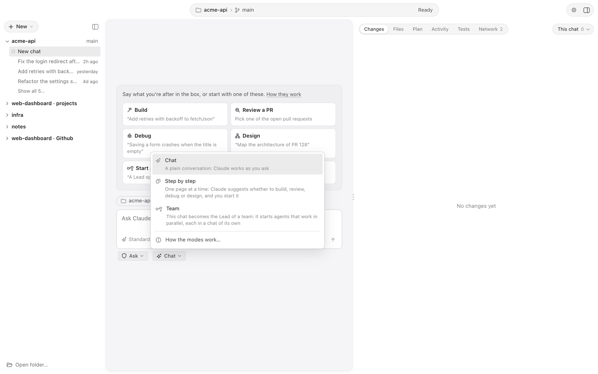

Permissions mean the same in every Workflow. Each project remembers its last Permissions and Workflow for its next chat, and you can switch in the middle of a chat (Claude is told with your next message). **How the modes work…**, at the bottom of either menu, explains each one, what Claude does in it and what you do:

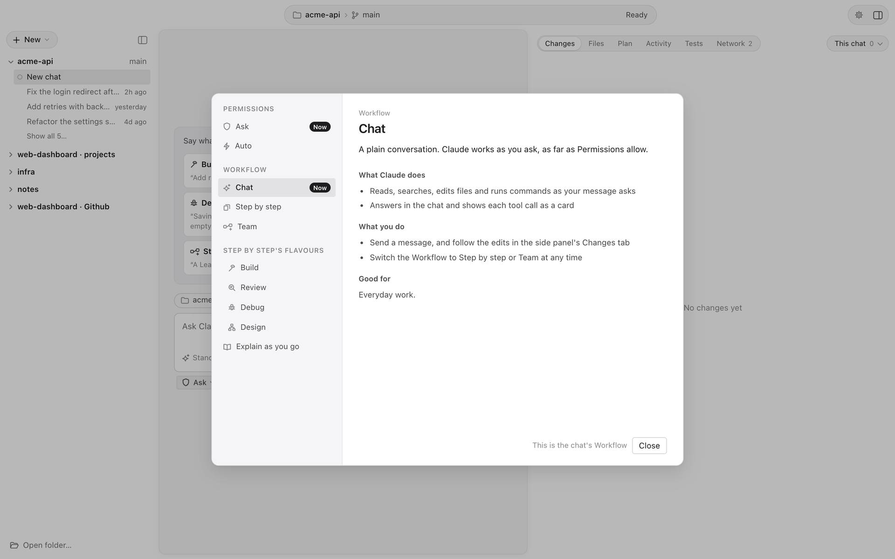

## A chat

Every tool call is a card, folded into a one-line summary ("Read 2 files, searched 1 time, ran 3 commands") that you can open. Edits and new files show as diffs, inline or in the side panel, and test runs get a line of their own.

When Claude wants to do something Permissions don't allow, a permission card appears in the chat with **Allow**, **Always allow…** (for this command, folder or chat) and **Deny**.

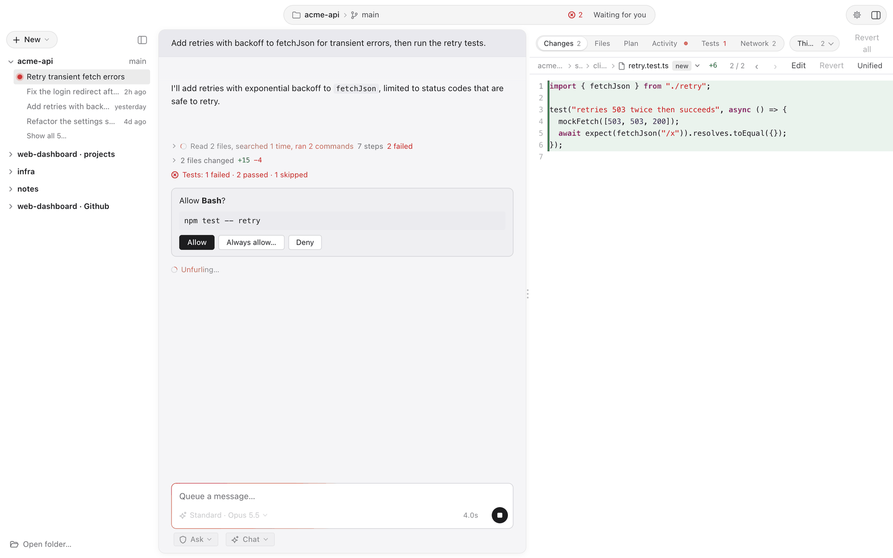

Under the box:

- **The Models chip** shows who does the work in this chat, like "Balanced · Sonnet 5.5". Its menu lists presets: Standard (your own model and effort, Claude Code's settings), Balanced (Sonnet, with Opus as the advisor Claude asks at decision points and Haiku subagents), Thrifty, Max, or your own. **Customize…** picks the model and thinking effort directly, and **Edit presets…** opens Settings → Harness. Changing a model on a preset makes the chat **Custom**, and the chip says so.
- **Permissions and Workflow** chips, as above.

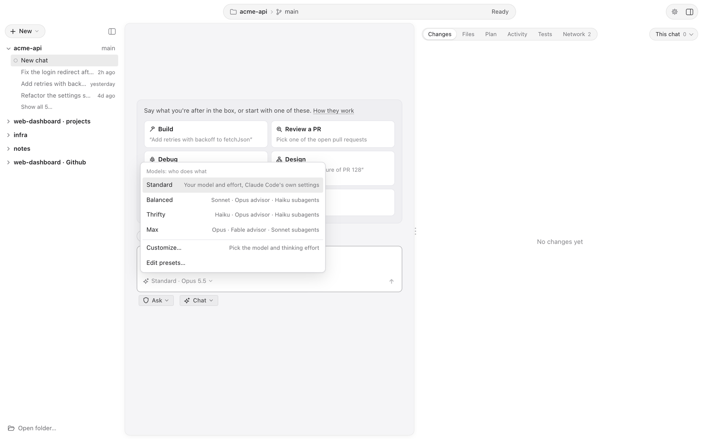

In the box:

- Type `/` for skills, commands and MCP prompts, and `@` to point Claude at a file.
- Start a message with `!` and the box becomes a terminal: `!git status` runs in the chat's folder and Claude sees the output with your next message (the hint under the box says so, and that backspace leaves the terminal). Long-running commands (a dev server) keep going until you stop them, and a prompt such as a password is answered in place.
- Pasting more than a few lines shows `[Pasted text #1 · 120 lines]`; the whole text is still sent.
- Send while Claude is working and the message is queued until its turn ends.

## Step by step

In Step by step, Claude writes one page per message and stops. You use **Next** to approve a page, ask about it in the box (the answer stays on the page), or ask for a change, and only that page is rewritten. **Send & next** (⌘Enter) sends a change and approves in one go. **Previous** goes back.

The header names the stages: **Frame → Plan → Build → Done** for Build (Debug has Frame, Evidence, Fix, Done; Review has Frame, Files, Summary; Design has Frame, Overview, Parts, Summary). The stage you're in is lit and holds a dot for each of its pages, earlier stages are checked, and clicking one goes back to it. The ← → keys move between pages as before.

Claude suggests how to work from your task, and starts when you say so. You can also pick a flavour yourself from the badge in the header, or from a card on the start screen.

### Build

Claude frames the task, plans one step per page (the files, the change, how to check it), then builds one step per page. The planning ends with a plan you can **lock**: Claude builds exactly those steps, and if the build shows the plan needs to change it stops on a **Plan update** page and asks first.

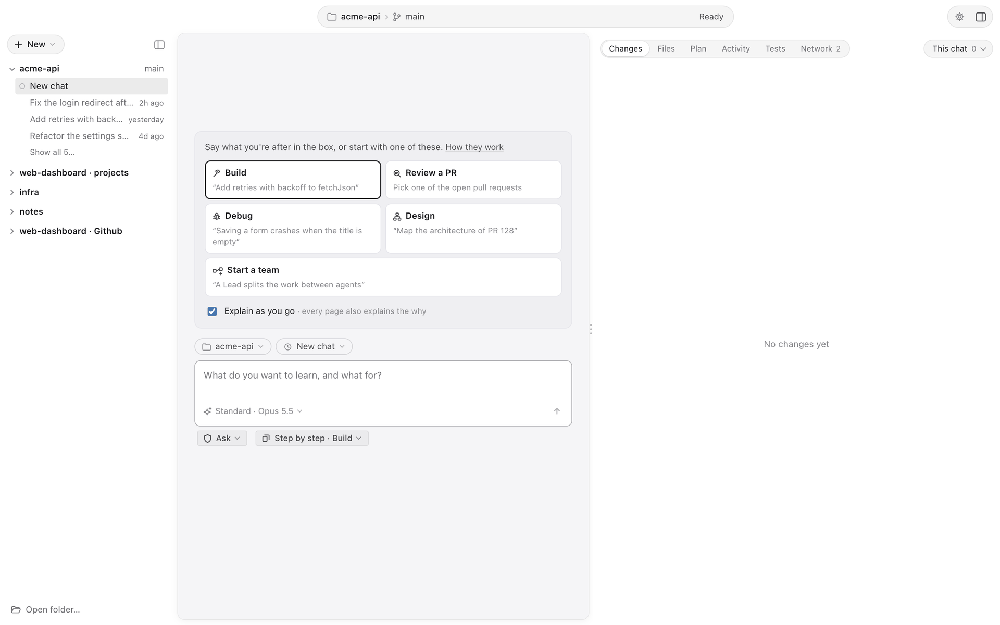

**Explain as you go** is an option on Build and Debug: every page also covers the why, with what else it could have been. Turn it on from the card, or from the flavour menu in the header at any time.

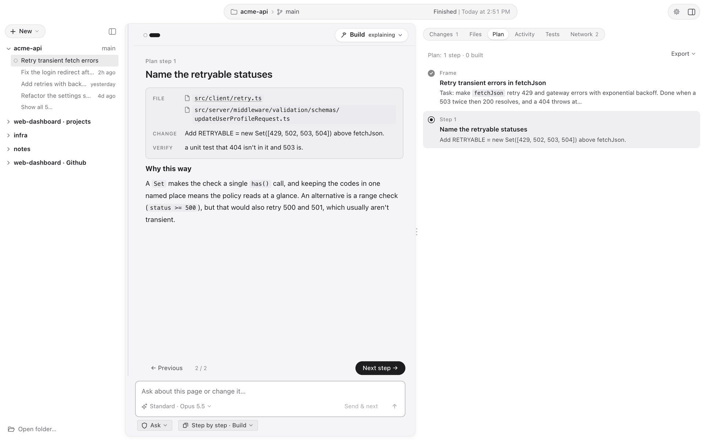

When the last step is built, the **Done** page ends on what to do next, as buttons: **Review the changes** (opens the side panel on Changes with everything the chat changed), **Commit…** and **Open a pull request…** (each shows the message it would send Claude and sends it only after you confirm; Lantern runs no git itself), **Export the plan** (the same export as the Plan tab's) and **Start something new** (a new chat in this project).

The plan is always in the side panel's **Plan** tab: each step, what was done, the files it changed, and whether it's built. A click opens the step's page, and **Export** copies or saves the plan as markdown.

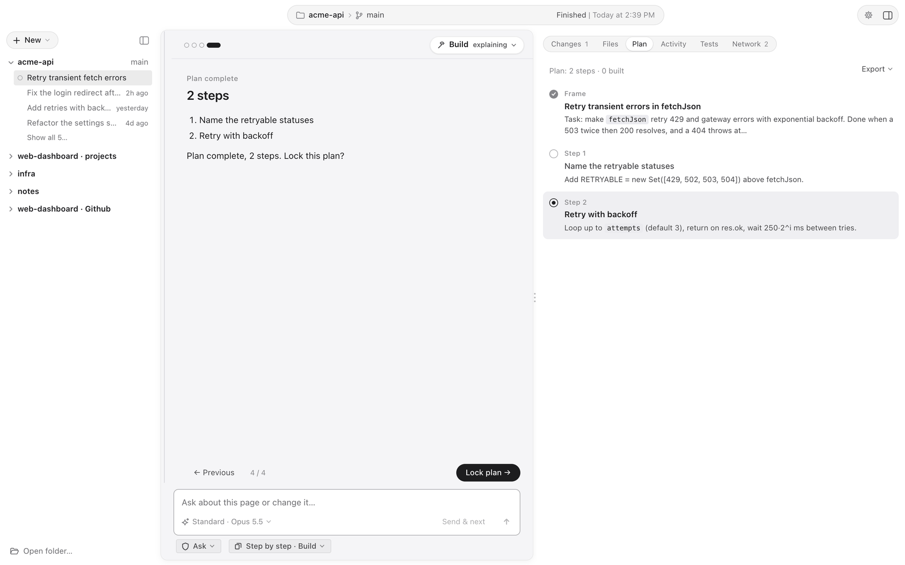

### Review

Point a review at a pull request or a branch. Nothing is posted to GitHub.

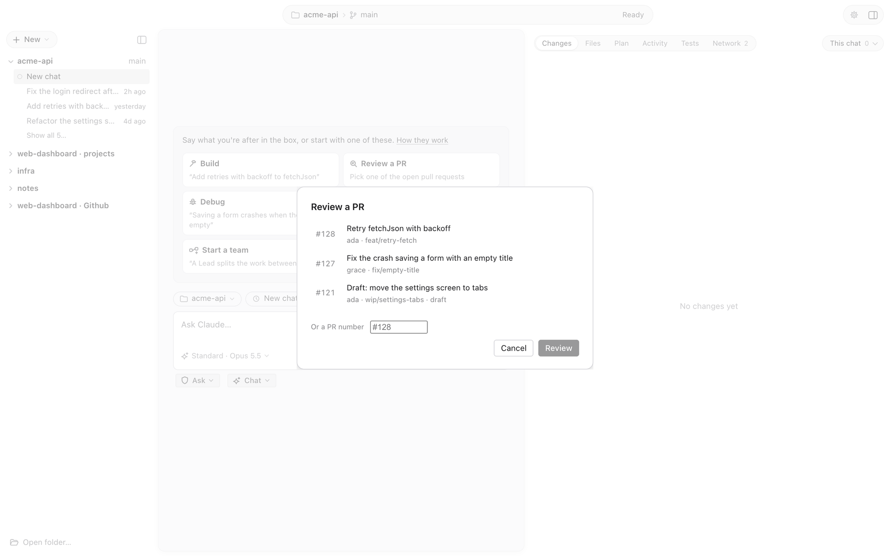

Each changed file gets its own page: what changed, then findings with a line and a severity (Blocker, Should fix, Nit). Each finding is a card you **Agree** with or **Reject**, and your verdicts go back to Claude when you press Next file. A rejected finding is dropped for good. At the end, Claude sums up and can write the findings up or fix them step by step.

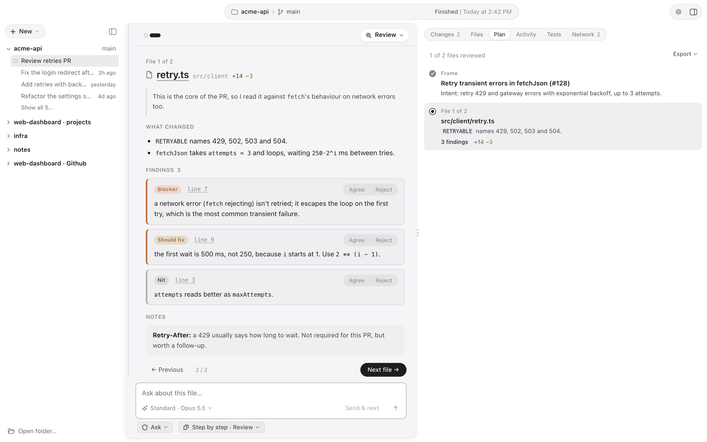

A branch stacked on another is compared with the branch it was built on, not the default branch. Claude names the base in the review's Frame.

### Debug

Claude frames the bug with the likely causes, most likely first, adds temporary logs (marked `lantern-debug`) that tell them apart, and reproduces the bug itself or hands you a card with the steps when only you can. You press **I've reproduced it** (and paste what you saw), or **Couldn't reproduce** and Claude adjusts the logs. It fixes the cause it confirmed and then removes every temporary log.

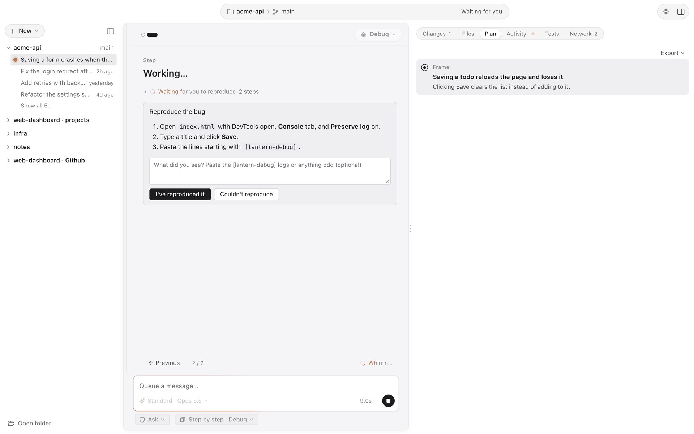

### Design

Design reviews the architecture, not the code. Claude draws the whole thing as one diagram, then goes through it a part per page, with concerns you agree with or reject. The map lives in the side panel's **Plan** tab (with a Map / Plan toggle):

- The layers are bands (UI, business logic, interfaces, implementations, external).
- Each box says whether it's done, in progress or planned.
- Every arrow that crosses a boundary is marked, and Lantern flags an arrow that goes around a layer.
- The problems Claude found are listed under the map; hovering one finds it on the map.
- The part you're on is lit, hovering a box says what it does, and clicking one opens its page.
- Drag to pan, pinch or ⌘-scroll to zoom, **Fit** to see all of it again.

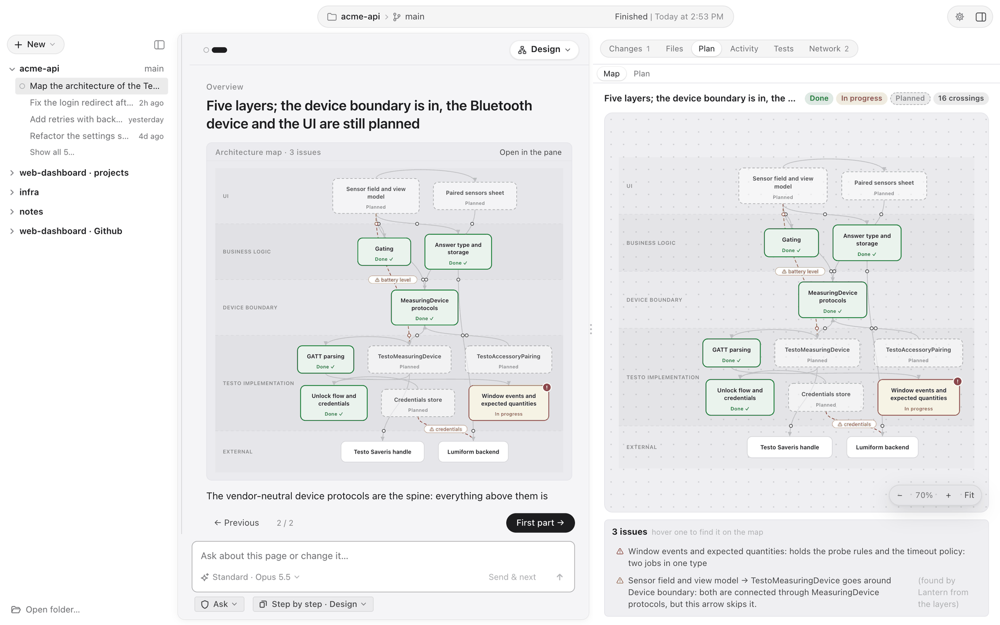

The same map in the dark theme:

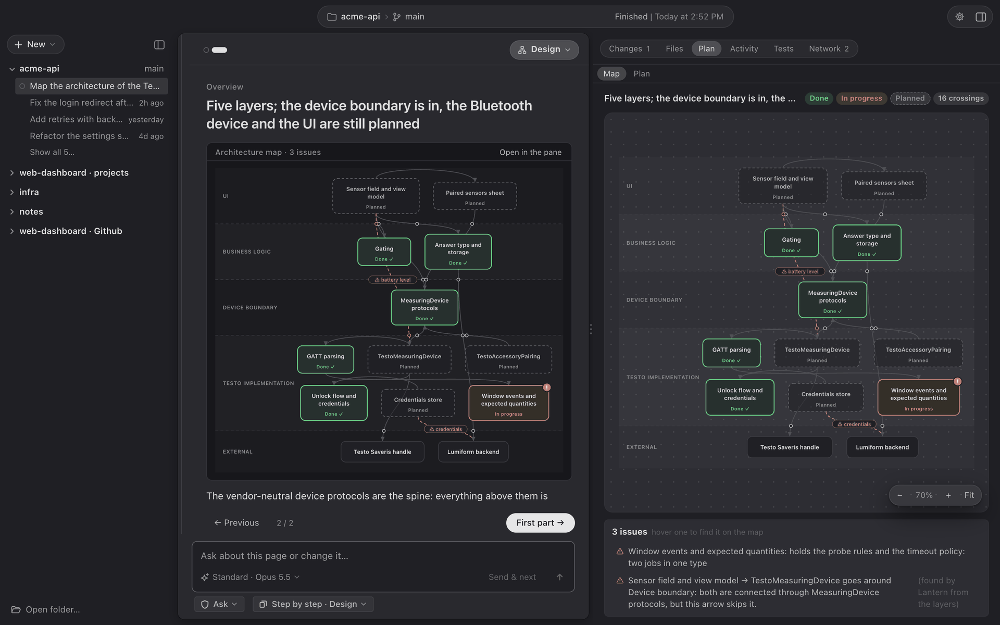

Any Mermaid diagram in a chat has **Expand**, to look at it full size.

## Teams

**Start a team** (the start screen's card, **New ▾ ▸ Team** in the sidebar, or ⇧⌘N) makes a chat that leads a team. You can also pick **Team** under Workflow in a chat you already have: it restarts on the same conversation as the Lead.

The Lead splits the work and starts agents, each in its own git worktree and branch (or in your folder, for work that only reads). It hears when they finish or need you, and can read and message any of them. You can talk to any agent directly too.

The app becomes a canvas of floating chats tethered to the Lead:

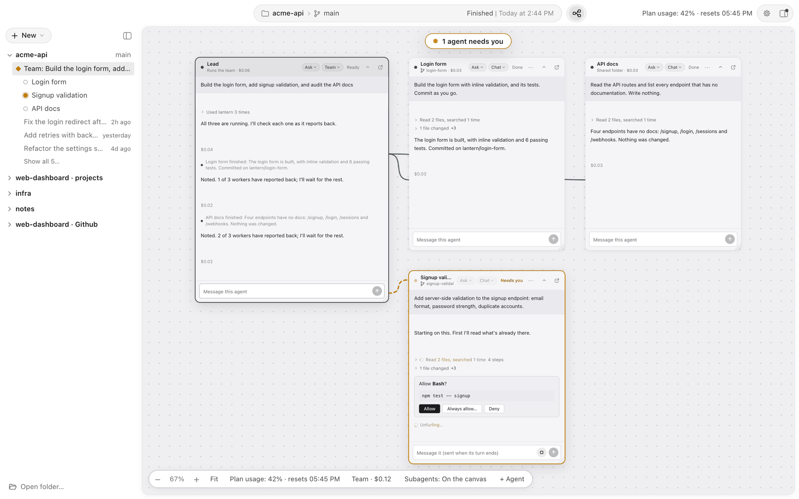

- Drag a title to move a window and its corner to resize it. Drag the background to pan; pinch or ⌘-scroll to zoom. Zoomed out, agents become cards, and a click zooms in.
- Every window says what its chat is doing in the same words: **Working**, **Needs you**, **Ready** (a Lead with nothing running), **Done** (an agent that finished its turn) or **Stopped**. The title bar says the same for the chat you're in, and the sidebar's rows say Working, Needs you or Done (Unread for a finish you haven't opened). A working agent that has been silent a while says "Working · 45s ago", and from three minutes on (you can change that, see below) it turns amber and reads **Quiet 3m**.
- **A quiet agent**: its window then has a line, "Quiet for 4 min. It may be stuck.", with three buttons. **Nudge** sends it a short message asking for a one-line status (once for each stretch of quiet). **Interrupt** stops what it is doing now; it stays on the team and you can message it. **Restart** starts it again and says first what that loses: the step it is in the middle of and anything running in the background (its chat and files stay). The Team list counts how many are quiet ("Team · 2 quiet") and marks them, and the title bar's inbox lists each one ("Quiet while working", with how long) with **Go**.
- An agent's permission prompts appear in its own window. The pill at the top ("1 agent needs you") takes you to the next one that does, at 100% so you can read it.
- Fitting everything (**Fit**, or a new agent arriving) never zooms out past 80% by itself. A team too big for the window is shown from the Lead at 80% and you pan to the rest; zooming out further is yours to do.
- Each window's title bar shows how full that agent's context is ("42%", amber from 75%, red from 90%). Click it for **Compact** (summarise the conversation to free up context) and **Clear** (a fresh conversation; the files stay, and you are asked first). Both wait until the agent has finished its turn.
- The **Context** chip in the toolbar opens a list of every agent with its share as a bar, its tokens, and Compact and Clear on its row. **Compact all above 60%** compacts every agent over that which is free, and says how many it skipped because they were busy. A name in the list goes to that agent.
- The title bar names the project (the Lead's folder, not an agent's worktree) and says where the team stands, like "4 working, 1 needs you", "all idle" or "1 failed".
- ⇧⌘C switches between the canvas and the chat view, and the sidebar lists the team, with its agents folded under a line ("3 agents · 1 needs you") that opens them.
- A team comes back when Lantern reopens, with the agents that were still going. An agent the Lead stopped, one whose worktree is gone, and one whose Lead isn't coming back are not reopened, and an agent's conversation is never listed among a project's past chats.

The same canvas in the dark theme:

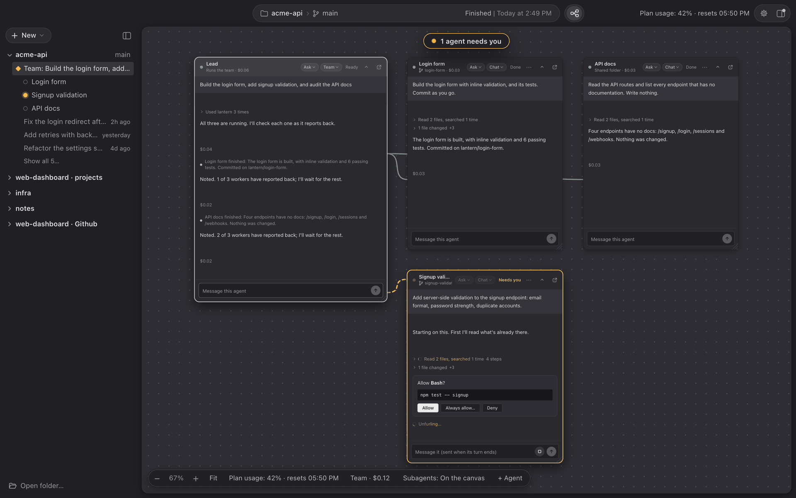

### Roles and templates

A **role** is a ready-made way to start an agent: what it is told, the model it runs on, where it works and whether it may change files. Pick one in **+ Agent** and the form fills in the rest; you can still change any of it, and the task you type goes into the brief. The agent is named from it ("Reviewer: login form").

| Role | What it does | Works in | May edit |
|---|---|---|---|
| Builder | Builds a change and reports what it did | its own worktree | yes |
| Reviewer | Reads a branch or diff and reports findings | your folder | no, read only |
| QA / tester | Runs the project's tests and tries to break the change; may write tests | its own worktree | yes |
| Docs | Writes and updates documentation | its own worktree | yes |
| Security auditor | Looks for security problems | your folder | no, read only |

Each role's brief asks for a report in a fixed, plain format (what it found, how serious, what to do). **Read only** is enforced, not just asked: the agent's editing tools are switched off, whatever its brief says, and its card says **Read only** in an amber badge under the title bar. (It can still run commands to read, such as git and the tests, and is told not to use them to change anything.) The role's name shows on the card, and in the sidebar's list of agents ("Reviewer · Working"). Docs is asked to touch documentation only; that part is a request, not a switch.

**Save as a role…** at the bottom of the form keeps what you filled in as a role of your own for the project. Choose it later from "Your roles", save again under the same name to change it, or **Delete this role**. Roles and templates belong to a project and move with it if the folder moves.

The Lead can ask for a role by name when it starts an agent, so its brief only says what to work on. An unknown role is refused with the list of roles there are.

**Team from a template** (**New ▾** in the sidebar, or the Workflow menu under the box) starts a team that already has its members chosen: **Build and review** (a Builder and a Reviewer) or **Build, review and test** (adding a QA tester). Say what the team should do, and the Lead is told each member and its role and starts them. **Make a template of your own…** saves a named list of roles (yours included) for the project.

### Merging

An agent works on its own branch, and only you can approve merging it. When the Lead asks, a merge card appears on its window and the agent's:

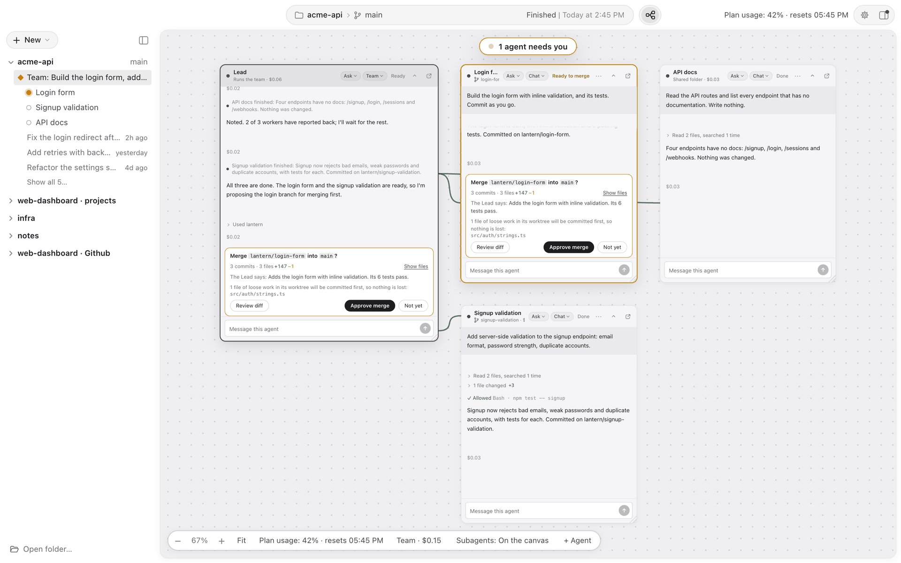

- **Show files** lists the files with their line counts. The arrow before a file opens its changes right on the card; its name opens it in the side panel.
- **Run tests** runs the project's tests in that agent's worktree, only when you press it. Lantern finds the command itself (a `test` script in package.json, Cargo.toml, pytest settings or a Makefile `test` target) and shows it next to the button; **Change** lets you type another, and it is remembered for the project. If Lantern can't tell, it says so and asks you to type one. What you type is shown back as the words it will run, and nothing goes through a shell (so `&&` and pipes are refused with a reason). While it runs you see the clock and the line it is on, with **Cancel**; a run stops by itself after 10 minutes. Afterwards the card says it plainly ("Tests passed: 214", "3 tests failed"), how long it took, and the end of the output on request. The result stays on the card, and says **Out of date** once the branch or its loose work has changed since. A run that leaves new files in the worktree says so, because they would no longer match what was proposed.
- **Approve merge** merges the branch into your folder. If the tests failed on this very branch, or are still running, the card asks once more (**Tests failed: merge anyway?**); with passing tests, no tests, or an out-of-date result it merges as before. If your folder has uncommitted changes, it says so and offers to try again.
- **Review diff** opens the side panel (which stays beside the canvas and remembers whether it was open) on that branch against its base, and each file listed opens its diff.
- **Not yet** leaves a quiet line that the Lead was told.

Settings → General has **Run tests when a merge is proposed** (off by default): with it on, the tests start by themselves as the card appears, when Lantern knows the project's test command.

### Usage

The canvas controls at the bottom adapt to the width of the canvas, so they never wrap or get cut off beside the side panel: first Subagents, **+ Agent** and Hidden fold into a **⋯** menu, then the team cost and the Context chip's agent name drop out ("82%"). Their **Context** chip is the share of the fullest agent's context window in use now; it turns amber from 75%, and the tooltip says to open that agent and use Compact (a click on the chip lists every agent's). The window is never guessed: it is what Claude reported for that agent's model (a model that has finished a turn in any chat counts for the others on it, and a `[1m]` model is 1M), and an agent whose window isn't known yet, such as a Lead still on its first long turn, shows its tokens ("312k") with no percent and no warning until it is. They show what the team has cost so far ("Team · $0.15") and **Plan usage**, how full your subscription's five-hour window is, with when it resets. It turns amber from 80% and red from 95%, and past 95% the Lead can't start new agents until the window resets. The meter is the account's, so it also shows in the title bar.

Press the title bar's meter to see **where it went**: the plan's line ("62% of the 5-hour window, resets in 1h 40m") and every open chat and team, in any project, biggest first, each with its state, what it has used since it started (cost and tokens, when known) and the models it ran on ("Sonnet 62%, Opus 38%", from its latest turn, Opus in amber). A team is one row with its total, and opens to its Lead and agents; pressing a name goes to that chat. The figures are per chat or team since it started, not just this window, and closed chats aren't counted, so they needn't add up to the plan's percentage. Esc closes it.

Each agent's **model** is on its window's title bar (the Lead's too) and in the Team list: "Sonnet" or "Haiku" quietly, "Opus" in amber, with the full model id as its tooltip, so an agent that has drifted onto Opus shows at a glance.

Starting a team (the Workflow menu's Team, New ▸ Team, Start a team, or **+ Agent** on a team) while another team is working asks first: "Another team is working (acme-api, 3 agents). Every agent spends the same plan. Start anyway?" **Don't ask again** turns it off; Settings ▸ General ▸ Teams brings it back.

**Subagents**, in the same controls, says where the Lead's built-in subagents (Claude Code's Agent tool, which runs inline where you can't see them) go:

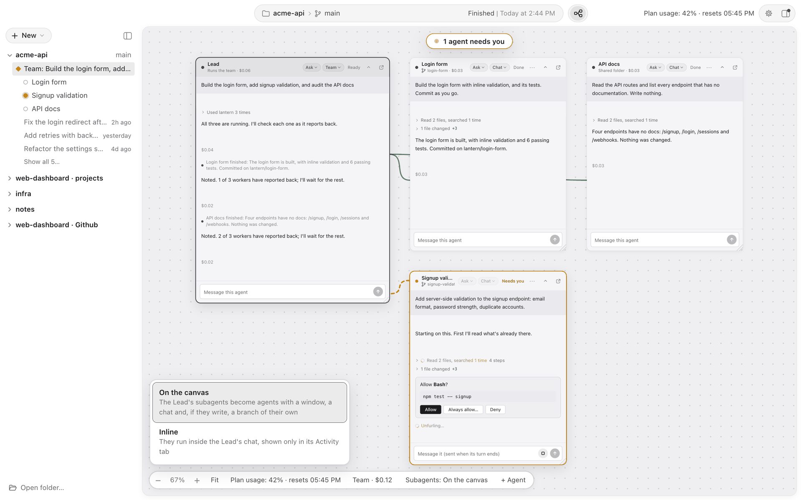

- **On the canvas** (the default): the Lead starts them as agents, with a window, a chat and, if they write, a branch of their own.
- **Inline**: they run inside the Lead's chat, shown only in its Activity tab.

A plain chat always runs its subagents inline.

**Agents running at once** is in Settings → General → Teams: how many agents can work at the same time across all teams. Every agent spends the same plan, and a Lead asking for one more is told to wait for one to finish.

**Say an agent is quiet after** (same place, 3 minutes until you change it) is how long a working agent may say nothing before it counts as quiet.

**Pause a team's work when my plan reaches** (Off until you choose, or 90% or 95%) keeps the teams from using up the plan unwatched. Five points before the limit a toast says so, once. When the plan reaches it while any agent of any team is working, Lantern stops what each of them is doing (they stay on their teams, nothing is closed) and shows a card at the top of the window and a row in the inbox: "Paused: your plan is 95% used, it resets in 1h 12m", with **Resume**. Nothing starts again on its own, not even queued messages or the agents' notes to a Lead; Resume tells each agent that was stopped "Continue where you stopped." A window of the plan is paused once: after you resume, it doesn't pause again until the next window.

The team runs on the Lead's Permissions, and an agent never gets more freedom than its Lead: change them from any window's title bar. A Lead can leave Team once its agents are closed.

## The sidebar and History

The sidebar is one pane with a group for every project that has a chat open, and nothing else: your past chats are in History (below). It has three states: **Expanded** (pinned open beside the chat), **Collapsed** and **Hidden**.

**Expanded** is the whole pane, at the width you gave it (drag its edge to resize):

- **New ▾** at the top starts a Chat (⌘N), a Team (⇧⌘N) or a PR review in the project on screen. The pin button above it collapses the sidebar (View ▸ Collapse sidebar, or Collapse sidebar in the command palette), and the **History** button under it opens History.
- A project's header has its initials in the colour the project has been given, its name, the branch when it is the project on screen, and a badge for how many things need you when it is folded. Click it to fold or open the project. Hover it for **+** (a new chat there) and **⋯**: New team, Close finished chats, Bring old chats here…, Reveal in Finder, Move up, Move down and Remove from recents (which only hides it; Claude Code keeps the chats).
- Under it are the project's open chats and teams as squares: the initials of the chat's title (a new chat is N) and a mark on its corner (a spinning ring while it works, an amber dot when it needs you, a blue dot when it finished while you were away), the title, and how it is. A team is one square (its Lead, with a small diamond badge) that shows the team's combined state. Its agents are folded under a line that says how many there are and who needs you or works; press it to list them (they stay listed while one of them is on screen). The collapsed column shows teams only. Each project has a colour of its own, kept across restarts (and when its folder moves): its squares are tinted with it, and the chat on screen is filled with it, with a bar beside it. A chat that needs you rises to the top of its group.
- Click an open chat to switch to it, a team to open its canvas, an agent to focus it there. **Open folder…** at the bottom opens another project.
- Every row has a **×** when you hover it (or tab to it) that closes the chat, and in the collapsed bar a right click has **Close chat** (and a small × shows on a square's corner). A chat that is done or only a draft closes at once, including the one on screen (Lantern then shows another chat, or the start screen). One that is working or waiting on you asks first, right under it: **Stop and close?** An agent is closed the way the canvas's *Clean up and close* does it: it checks for uncommitted and unmerged work and asks before deleting any. A team's Lead asks **Close the team and its N agents?** and says what would be lost. A project's ⋯ has **Close finished chats**, which closes every chat that is done (not the working ones, drafts or teams) and says how many.

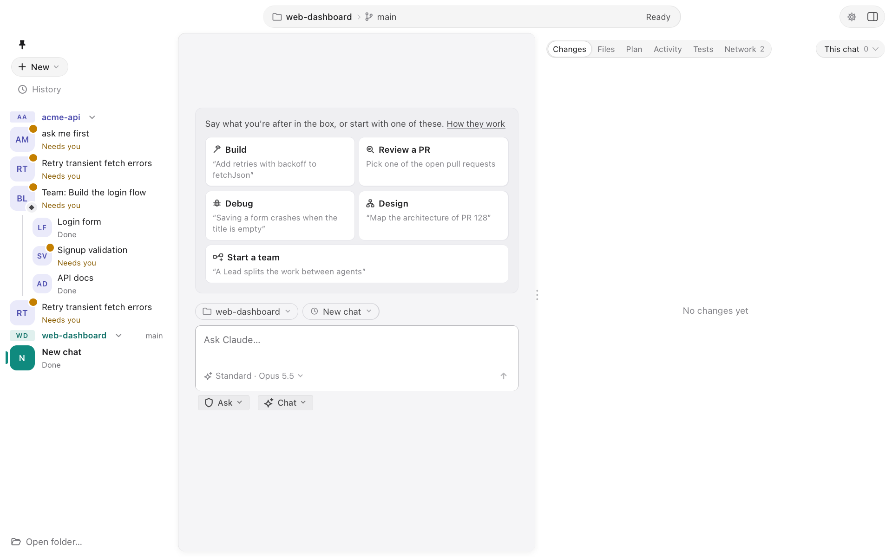

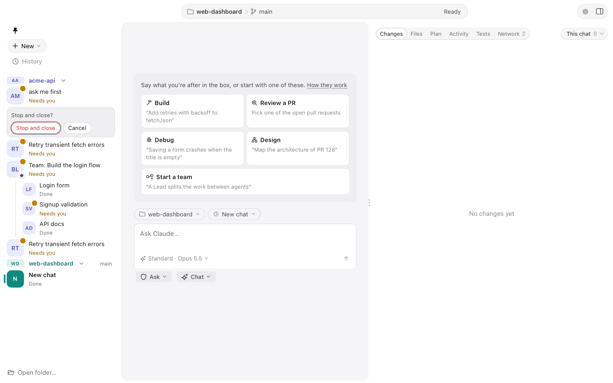

**Collapsed** is the pin button again (or the button at the top of the bar, Expand sidebar, when it is collapsed). It becomes a slim column with a small square for each open chat and team, not for each project. The squares are the same ones, each project's under its initials in its colour, **+** at the top starts a chat and the clock under it opens History. When there are more squares than fit, the column scrolls.

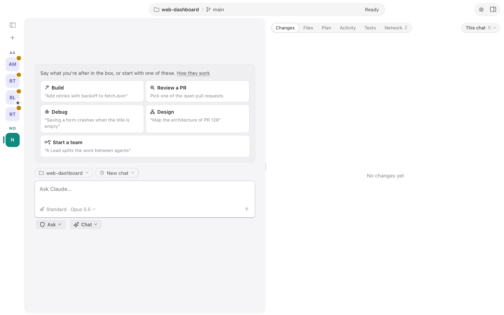

Rest the pointer on the collapsed column for a moment and the same pane opens over the chat: the squares stay where they are, and the titles, the project headers and the rest slide out beside them. Click a chat to go there and it folds back, as it does when the pointer leaves or you press Esc. Moving focus into it from the keyboard opens it too. Its pin button keeps it open (expanded).

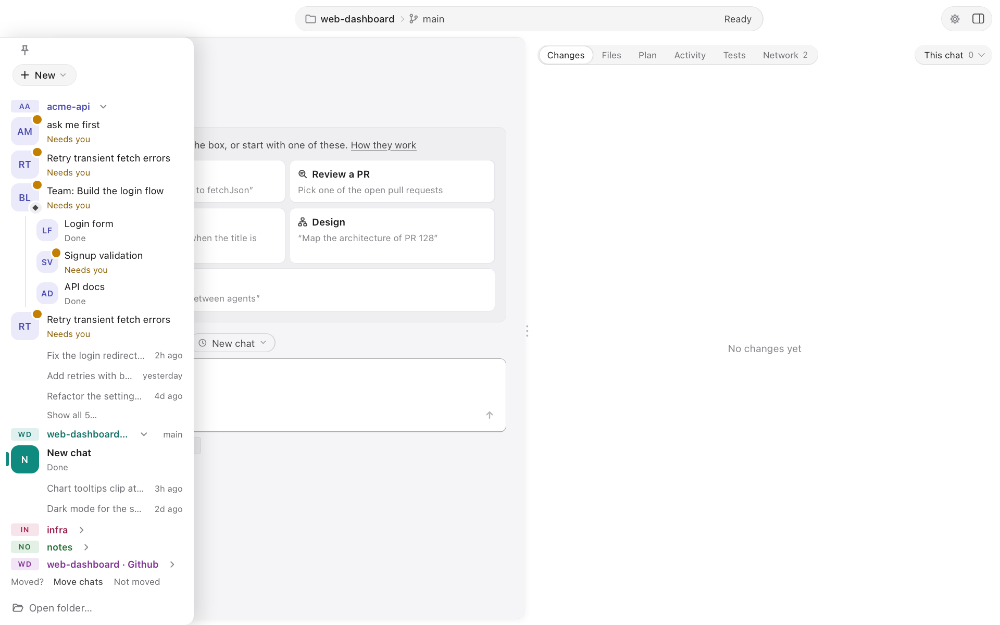

**Hidden**: **⌃⌘S** (View ▸ Hide sidebar, or Hide sidebar in the command palette) hides the sidebar completely, and the chat takes the whole width. A **Show sidebar** button then sits at the left of the title bar. When a chat or an agent needs you, it carries an amber badge with how many, so a waiting chat is never hidden: click it, or press ⌃⌘S again, to bring the sidebar back as it was (Expanded or Collapsed). The tray button at the right of the title bar is the separate Away inbox (see Away below), and is there in every state.

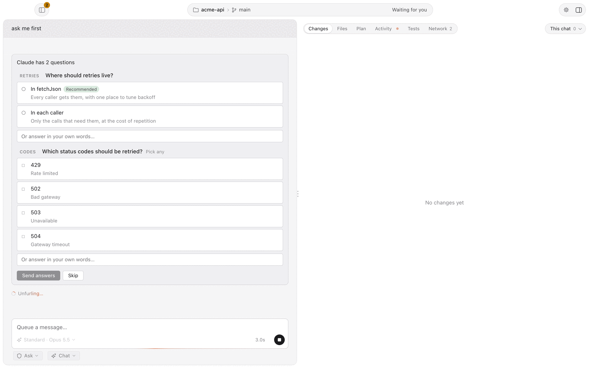

To look without showing it, rest the pointer on the window's left edge for a moment and the sidebar slides in over the chat, in the same way. To keep it open, use its pin button or ⌃⌘S.

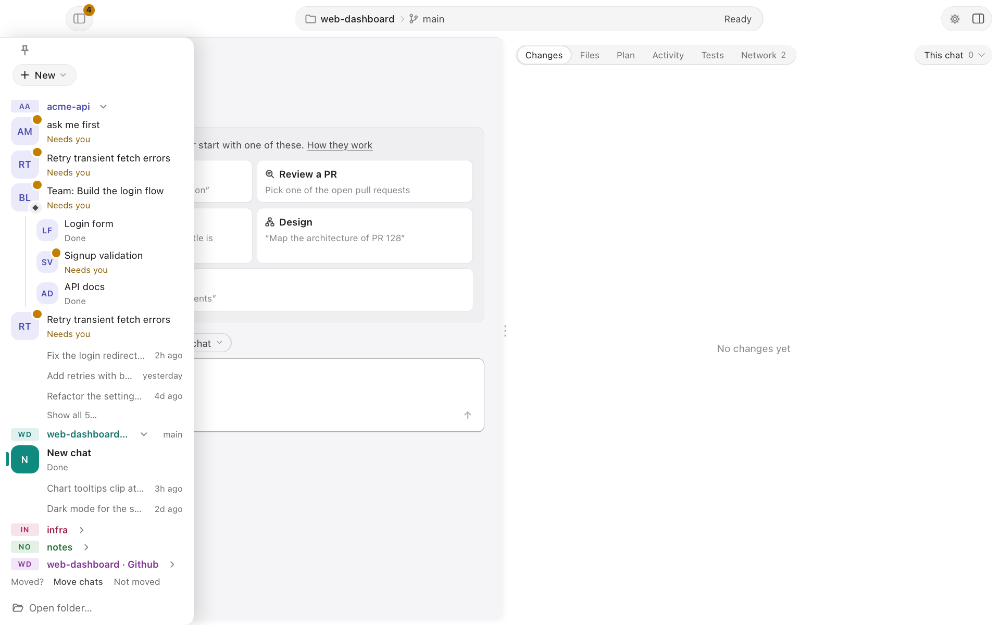

Projects stay in the order you give them; using one doesn't move it. A project you open for the first time goes at the top. To reorder, drag a project by its header: it lifts, the others slide out of its way, and it settles where you drop it (Esc puts it back). From the keyboard, ⌥⌘↑ and ⌥⌘↓ move the project whose header has focus, and its ⋯ menu has Move up and Move down. The collapsed bar follows the same order, and the order is remembered.

Its width, whether it is collapsed and whether it is hidden are each remembered, so showing it again restores it.

The team canvas screenshot shows a team with its agents nested under it.

**History** (the clock button in the sidebar, or ⌘K; View ▸ Chat History, or Chat history in the command palette) lists the past chats of every project, including ones started in the terminal with Claude Code, grouped by project in the sidebar's order. A project's pinned chats come first, then the newest. Type to search all of them, or pick a project in the chip beside the search box. ↑ and ↓ move through the chats, Return opens one in its own project, and Esc (or ⌘K again) closes it. Each chat's ⋯ pins, renames, exports it or copies the command that picks it up in a terminal. The chats that are open are in the sidebar, so History leaves them out. It works with nothing open too: each project's header has a **+** that starts a chat there, which is how to start a project that has nothing open (the other ways are **New ▾**, **Open folder…** and the folder menu in the title bar).

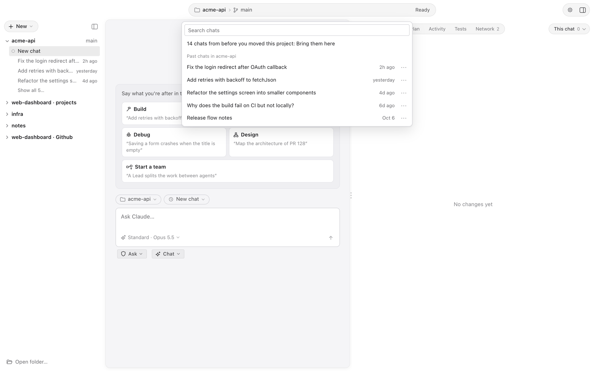

After you move a repository, Claude Code leaves its chats under the old path. **Bring old chats here…** (the folder menu in the title bar, a project's ⋯ menu, or the palette) finds the places the project was before and copies the chats you check into its History. Nothing is moved or overwritten, and nothing happens until you confirm.

## Away

People start work and walk away, so two things help while you are gone.

**What needs you.** The tray button at the top right of the title bar (always there, whether the sidebar is expanded, collapsed or hidden; also **What Needs You…** in the command palette) opens a list of everything waiting on you across every open project and team: permission requests and questions, plans to approve, merges to approve, a team held back until you say go on, and chats that finished while you were elsewhere. Each row shows the chat or agent, its project (and team), what it needs in plain words and how long it has waited. **Go** takes you there; a plain permission request also has **Allow** and **Deny** right in the list. What needs an answer comes first, longest waiting first, then what only finished. The button's badge counts what needs an answer; a small blue dot means only unread finishes. Arrow keys move between rows (Left and Right between a row's buttons) and Esc closes it. macOS notifications are separate (see Settings).

**Keeping the Mac awake.** While any chat or agent is working, or paused on a question for you, Lantern stops the Mac from going to sleep on its own, so a long turn finishes while you are away (it holds macOS's `caffeinate` for as long as that lasts, and lets go when nothing is working or Lantern quits). Only idle sleep is prevented: the screen may still turn off, and closing the lid still sleeps the Mac. Turn it off in Settings ▸ General ▸ **Keep my Mac awake while Claude works**.

## The side panel

The side panel (⌘\ shows or hides it) always has six tabs, in this order. A tab with nothing to show yet says what will show there.

**Changes.** Every file Claude touched, as a diff. Pick a file to see it in a full diff beside the chat, step through the files (or press `j` and `k`), switch between unified and split, edit the file, or **Revert** it (or **Revert all**). The button at the top right chooses what it compares: this chat's edits, or a whole branch. The first screenshot under [A chat](#a-chat) shows it.

**Files.** The project's files, with search by name (⌘P) and by text (⌘⇧F). A file opens in an editor with completion, hover docs and syntax errors for TypeScript, JavaScript, JSON, CSS and HTML: change it and press ⌘S. The change shows in Changes like Claude's, and if Claude (or git) changes the file while you have unsaved edits, you choose between your version and the one on disk before anything is overwritten. A markdown file opens as a styled document; **Edit** switches to the editor.

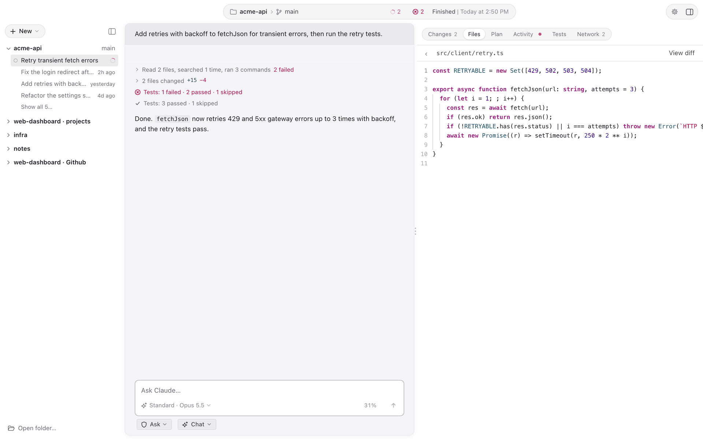

**Plan.** In a Step by step chat, the plan so far (Build) or the architecture map (Design), as described above. A chat without one says so.

**Activity.** A live graph of the turn: the Lead at the root, the advisor beside it, subagents below with the model each runs on, and the kinds of tools each used, with work travelling the edges as it happens. Under it, a log of who did what, then what the turn cost per model.

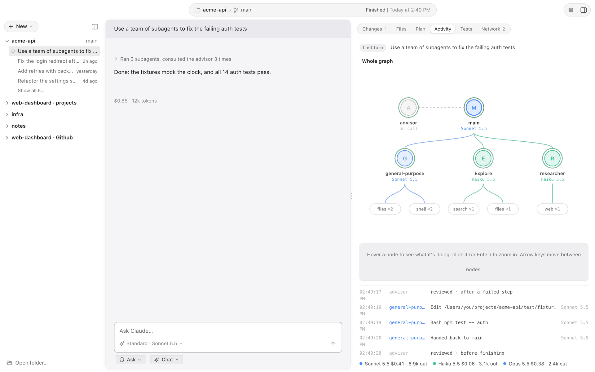

**Tests.** Test runs appear here when Claude runs your tests. Runs of pytest, jest, vitest, cargo and xcodebuild are parsed into passes and failures, with `file:line` links to the failing line.

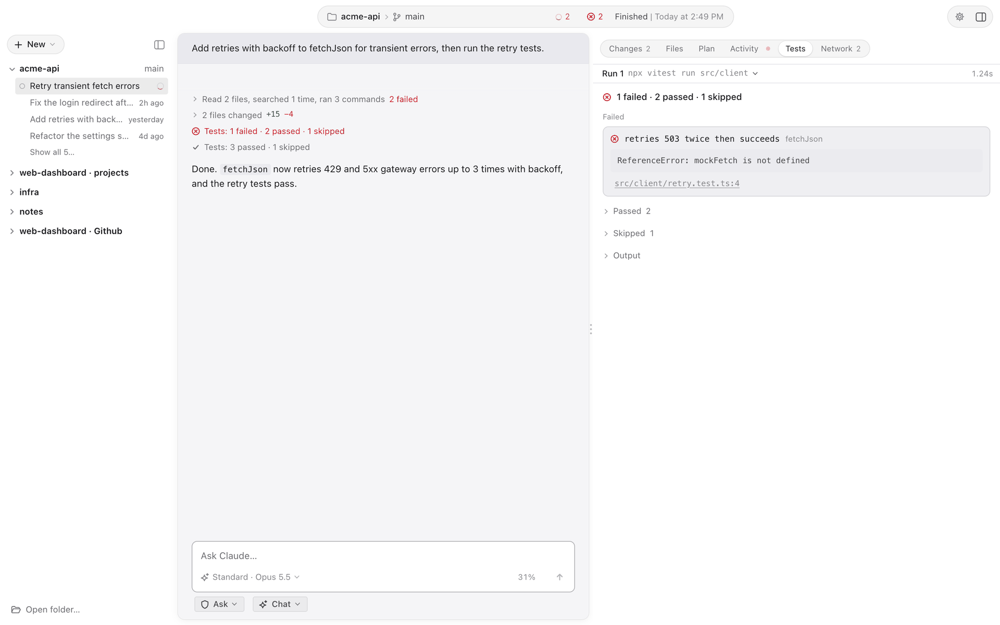

**Network.** Shows requests captured by [Network Monitor](https://github.com/alyakan/network-monitor), a separate app that acts as a proxy for your own app's traffic. With it open as your app's proxy, Claude can search and read what it captured. Tell Claude which requests matter and it saves a **watch** for the project; the tab then lists every matching request as it happens, newest first, with the response as a foldable JSON tree, an outline of its keys, and its headers. **Summarize** asks Claude to read a response and put a summary above the JSON.

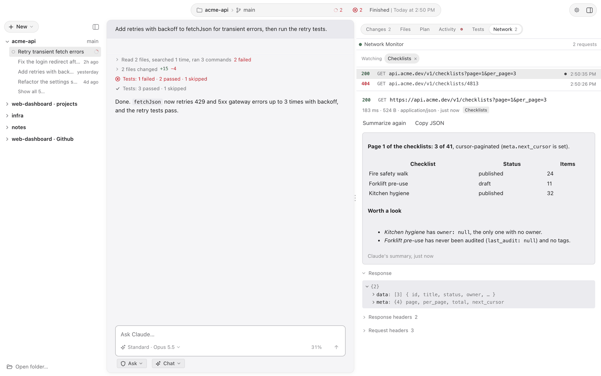

A few things to know:

- What Claude reads has auth headers, cookies, and URL parameters and JSON or form fields with credential-like names (`token`, `password`, `secret`…) redacted. Anything else in a body reaches it as it is.
- Watches and summaries are kept per project. The responses themselves stay in memory, never on disk.
- The traffic itself isn't per project: Claude in any chat can search everything Network Monitor captured, not just what a project's watches match.
- Until there's a watch, the tab explains Network Monitor and how to add one.

## Settings

**⌘,** opens Settings, with six tabs:

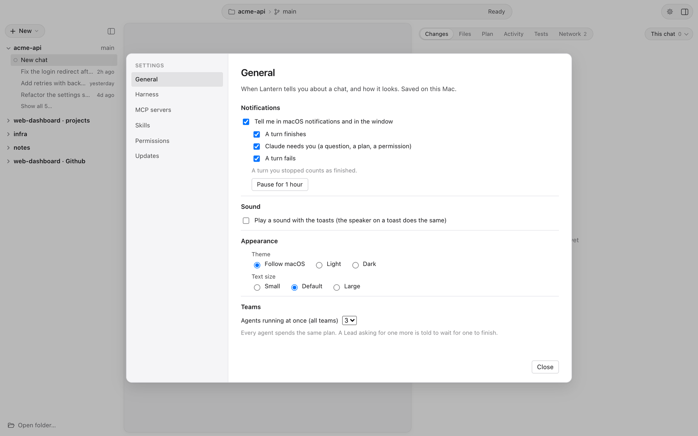

- **General**: which events notify you (a turn finishes, Claude needs you, a turn fails), a pause for an hour, the toast sound, keeping the Mac awake while Claude works, the theme (see below), the text size, and, for teams, **Agents running at once**, **Say an agent is quiet after** and **Pause a team's work when my plan reaches**.
- **Models**: the model presets (who is the Lead, the advisor and the subagents) that the Models chip offers.
- **MCP servers**: your servers with their status. Log in, reconnect, turn off, add, edit or remove them (through Claude Code's own settings). When one is down or needs you to log in, a small amber dot sits on the Settings gear in the title bar (hover it to see which), and the `/` menu says so too. A secret never goes into the project's committed `.mcp.json`.
- **Skills**: the project's and plugins' skills, each with a preview of its file.
- **Allow rules**: the rules you saved with **Always allow…**, each on one line with its scope (this chat or this folder), what it covers and a **Remove** button. (The tab isn't called Permissions, so it can't be mistaken for the Permissions chip under the chat box.)
- **Updates**: Lantern updates itself. When a new release is out, "Update ready" appears under the chat box; click it to restart onto the new version, or leave it and it installs when you quit. **Lantern ▸ Check for Updates…** looks right now.

### Themes

Settings ▸ General ▸ Theme picks how Lantern looks, with a small preview of each:

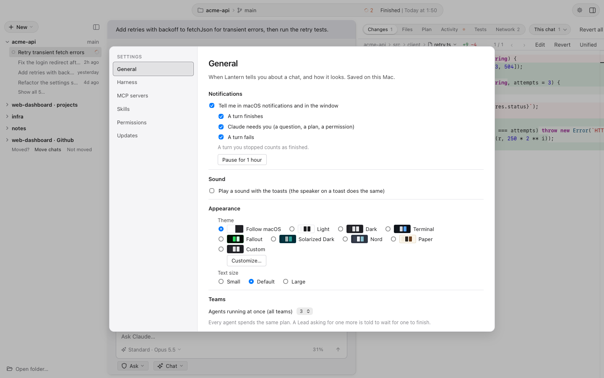

- **Follow macOS**, **Light** and **Dark**, as before.
- **Terminal**: a modern terminal scheme (think Warp or Ghostty): near-black with a cool tint, light text, monospace everywhere, square corners and thin lines instead of shadows. Colour is used the way syntax highlighting does: green for what you typed and for additions, yellow for "working", red for errors and removals, blue for links, purple for emphasis. **Bold** is white, `inline code` is an orange chip, headings are cyan and a quote has a purple bar.
- **Fallout**: a Pip-Boy terminal, all phosphor green on green-black, in three levels: bright for headings and bold (with a soft glow), normal for text, dim for what is secondary. Inline code and code headers are in reverse video (dark on bright green), code blocks and what you send sit in boxes (what you send starts with a `>` prompt), small labels are in capitals, the cursor in the chat box is a block, and faint scanlines and a darkened edge sit over the window. They are still, don't catch clicks, and text keeps its contrast (4.5:1 or more).
- **Solarized Dark**, **Nord** and **Paper** (a warm light theme): colours only.
- **Custom**: **Customize…** opens six colour pickers (background, panels, text, secondary text, accent and lines), a **Monospace everywhere** switch and a **Rounded or Square** corners choice. It starts from the theme you have now, the app changes as you pick, and it warns you when your text colour would be hard to read on your background (under 4.5:1). The rest of the colours are worked out from your six.

The code editor and diffs, diagrams and shell output follow the theme, and a chosen theme is on before the first screen is drawn, so nothing flashes the default.

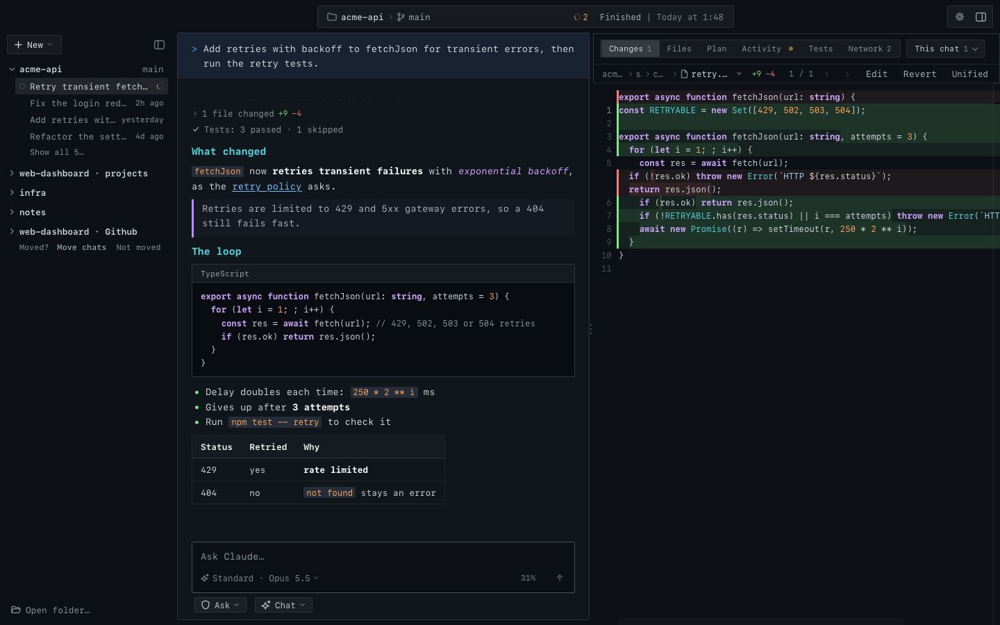

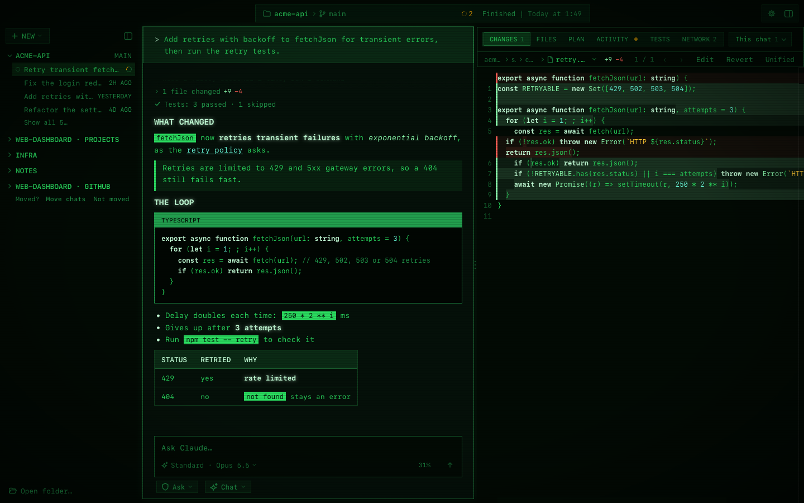

## Keyboard shortcuts and the command palette

**⇧⌘P** opens the command palette: every action in Lantern by name, with its shortcut (titles in sentence case, like "Chat history"), plus ones with no shortcut such as "Permissions: Auto", "Workflow: Team", "Models: Max" and "Settings: Skills".

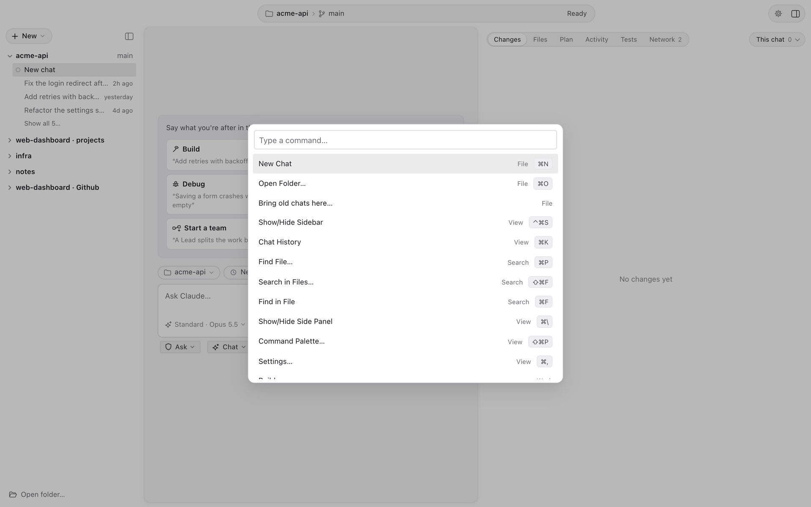

**⌘/** shows the full list of shortcuts, with the ones that can't be used right now dimmed. The ones you'll use most:

| Shortcut | What it does |
| --- | --- |
| ⌘N | New chat |
| ⇧⌘N | Start a team |
| ⌘O | Open folder |
| ⌘K | History |
| ⌃⌘S | Show or hide the sidebar |
| ⌘\ | Show or hide the side panel |
| ⇧⌘P | Command palette |
| ⌘P | Find a file by name |
| ⇧⌘F | Search text in files |
| ⌘F | Find in the open file or diff |
| ⌘S | Save the file in the editor |
| ⌘Enter | Send & next (in Step by step) |
| ⌘L | Focus the message box |
| ⌘. | Stop Claude |
| ⇧⌘C | Switch between a team's canvas and chat view |
| ⌘= ⌘- ⌘0 | Zoom the canvas in, out, and fit everyone |
| ⌘] ⌘[ | Next and previous agent on the canvas |
| `j` `k` | Next and previous changed file (outside the message box) |
| ⌘, | Settings |
| ⌘/ | Keyboard shortcuts |
